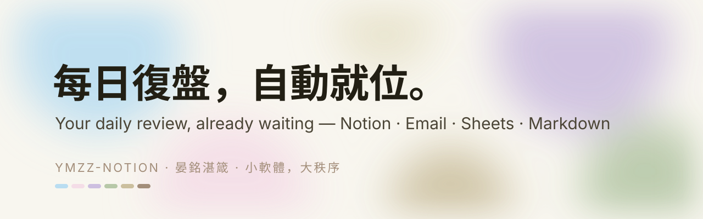
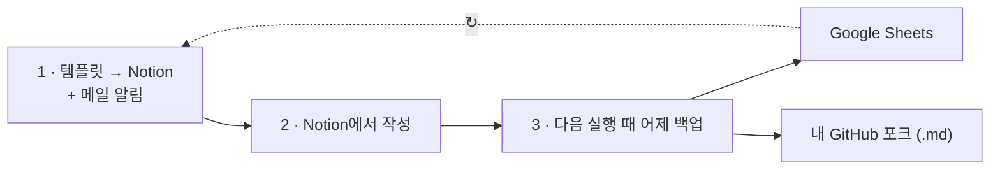

<p align="center"></p>

<p align="center"><a href="README.md">English</a> · <a href="README.zh-Hant.md">繁體中文</a> · <a href="README.zh-CN.md">简体中文</a> · <b>한국어</b></p>

<p align="center">
<a href="https://github.com/Ya-MiC/ymzz-loop/actions/workflows/ci.yml"></a>
<a href="LICENSE"></a>


</p>

<h1 align="center">ymzz-loop</h1>
<p align="center"><b>매일의 회고를 순환으로: Notion에서 쓰고, Google Sheets(선택: Feishu, docs/feishu.md)와 내 GitHub에 보관.</b><br>Notion, Google, 이메일은 한 번만 연결하세요. 그 뒤로 매일 내 포크에서 실행되는 GitHub Actions가 새 회고 템플릿을 Notion에 넣고 메일로 알려 주며, 다음 실행 때 작성한 내용을 Google Sheets와 저장소의 Markdown으로 백업합니다.<br>$0 · any time zone · no servers · no AI quota</p>
<p align="center"><a href="https://ya-mic.github.io/ymzz-loop/">웹사이트 & 설정 가이드</a> · <a href="docs/architecture.md">아키텍처</a></p>


## 순환은 이렇게 작동합니다



1. **도착** — 정한 시간에 빈 회고 템플릿이 Notion에 만들어지고 링크가 담긴 메일이 옵니다.
2. **작성** — 어떤 기기에서든 작성하세요.
3. **보관** — 다음 실행 때 어제 기록이 Google Sheets와 내 포크의 `notion/YYYY/*.md`로 복사됩니다. 그리고 매일 반복(최대 600일)됩니다.


**수명:** 첫 성공 실행부터 최대 **600**일 후 게이트가 멈추고 스케줄이 비활성화됩니다. Notion·Sheets·Markdown은 그대로 당신의 것입니다.

## 하는 일
정한 시각(기본 **07:00 UTC**)에 GitHub Actions가:
1. Notion에 오늘의 빈 회고 페이지(①–⑩ 섹션)를 만들고,
2. 그 페이지 링크를 메일로 보내고,
3. **어제** 회고와 현재 보유 현황을 Google Sheets와 이 저장소의 `notion/YYYY/MMDD_HHMM_<시간대>.md`(예: `1105_0705_utc.md`)에 동기화합니다.

GitHub 무료 Actions 시간과 무료 Notion/Google API만 사용합니다. 실패하면 메일로 알려 줍니다.

## 시간대
저장소 Variables `YMZZ_TZ`(예: `America/Los_Angeles`, `Asia/Seoul`)와 `YMZZ_REMIND_TIME`(`HH:MM`)을 설정하거나 `sync.config.json`의 `timezone` / `remind_time`을 수정하세요. 기본값은 `Etc/UTC` `07:00`입니다. 워크플로는 매시간 깨어나고, 정한 시각이 지나고 오늘 아직 실행하지 않았을 때만 진행합니다.

## 설정 (한 번, 약 15분)
1. **Notion 통합** — https://www.notion.so/profile/integrations → New integration(Internal) `ymzz` → 토큰 복사 → 회고 페이지 `⋯` → Connections → `ymzz` 추가.
2. **데이터베이스 생성**(Node.js 20+):
   ```bash
   git clone https://github.com/<you>/ymzz-loop && cd ymzz-loop
   NOTION_TOKEN=<token> ./setup.sh "https://www.notion.so/<페이지>"
   git add sync.config.json && git commit -m "setup ids" && git push
   ```
3. **Google 서비스 계정** — Google Cloud Console → Google Sheets API 사용 설정 → 서비스 계정 → JSON 키. 시트를 서비스 계정 이메일에 편집자로 공유. `/d/<SHEET_ID>/edit`.
4. **Gmail 앱 비밀번호** — https://myaccount.google.com/apppasswords (2단계 인증 필요).
5. **GitHub Secrets** — `NOTION_TOKEN`, `GOOGLE_SERVICE_ACCOUNT_JSON`, `SHEET_ID`, `SMTP_USER`, `SMTP_PASS`, `MAIL_TO`.
6. **시간대(선택)** — Variables 탭에 `YMZZ_TZ`, `YMZZ_REMIND_TIME`.
7. **첫 실행** — Actions → daily-review → Run workflow.

## 확장
새 대상은 파일 하나: `scripts/sinks/<name>.mjs`에 `{ name, enabled(env), write(ctx) }` 구현. [docs/architecture.md](docs/architecture.md) 참고.

## 라이선스
[MIT](LICENSE) © 2026 YanMing Cao · **晏銘湛箴** — 작은 소프트웨어, 큰 질서.
ymzz-loop은 독립 프로젝트이며 Notion, Google, GitHub, Interactive Brokers와 제휴하지 않았습니다.

## Donate / 贊助

ymzz-loop는 **무료 MIT**입니다. 팁 환영.

**USDC on Arbitrum One only. Sending other tokens or using other networks may lose funds.**

```
0x9C4345b0a652D063a79321fe099C65a7Dc5a9C3A
```

수신 전용: https://ya-mic.github.io/ymzz-loop/#donate

