# 稟冊

稟冊是晏銘湛箴（ymzz）的本機私人事務稟報，也是 Alipay PAYATHON 2026 **Vibe Pay 賽道**的作品。設計 Skill 那一份是另一個儲存庫的 Skill 賽道，不在這裡。這份作品留在你這台電腦上，把檔案、對話、復盤和沙箱收款收成一份給你看的彙報。稱呼、電話和金鑰不送走。

「稟」是呈給擁有者的報告，「冊」是留在本機的那一本。產品要交的是這份彙報，不是一個搜尋框，也不是放在別處的共享資料庫。

沙箱收款是 Vibe Pay 沙箱：建立訂單、簽名通知、簽名查單、交付和退一部分。頁面跳回來不算付款。不會真的扣款，也沒有放正式商店的帳號。這不是得獎聲明，也沒有付費用戶。

安裝檔名是 `ymzz-bingce`。視窗標題是「稟冊」。

## 下載

0.21.1 的安裝檔由 [安裝檔工作流程](https://github.com/Ya-MiC/ymzz-loop/actions/workflows/installers.yml) 在分支 `cursor/v0211-mobile-core-e023` 上產生，掛到**新的草稿預發行** `v0.21.1-preview`。那份草稿要等工作流程成功才會出現，而且不會公開、不會收費。0.21.0 的草稿還在，沒有被這次改掉。兩份都要登入這個儲存庫才看得到：[Releases](https://github.com/Ya-MiC/ymzz-loop/releases)。

GitHub 這個儲存庫的預設分支仍是 `main`，所以儲存庫首頁看到的不是這份說明。產品說明在 `product` 分支。

| 系統 | 你要下載的檔 | 現況 |
| --- | --- | --- |
| Windows | `.msi` 與 `.exe` | 0.21.0 草稿裡已有。0.21.1 要等新草稿。裝好之後，核心在視窗旁邊，頁面走 `127.0.0.1` |
| macOS | 未簽名的 Apple 晶片 `.dmg` | 同上。被系統擋住時，對檔案按右鍵選「打開」 |
| Linux | `.deb` 與 `.AppImage` | 同上 |
| Android | 未簽名的側載 `.apk`。上架要用 `.aab` | 0.21.1 把本機核心編進同一個程式，不再只是空殼。模擬器有沒有打開稱呼和彙報，以工作流程的截圖為準，截圖會放在 `docs/mobile/`。沒有 `.aab`，沒有上架 Google Play |
| iOS | 模擬器 `.app` | 同一支核心會編進模擬器目標。沒有 `.ipa`，沒有簽給真機，沒有 TestFlight 或 App Store。那需要你自己的 Apple 開發者帳號。模擬器有沒有真的打開，以工作流程為準 |

上一版草稿（0.21.0，要登入）：https://github.com/Ya-MiC/ymzz-loop/releases/tag/untagged-4bf6ff0326917ba02f0e

上一版成功的工作流程：https://github.com/Ya-MiC/ymzz-loop/actions/runs/42803995058

### macOS 被系統擋住時

安裝檔沒有簽名。打開時若出現「無法驗證開發者」：

1. 在 Finder 對 `ymzz-bingce` 按右鍵，選「打開」，再按「打開」。
2. 或到「系統設定 → 隱私權與安全性」，在封鎖訊息旁邊按「仍要打開」。

### Android 上架清單（還沒做）

Google Play 要你自己的開發者帳號，這份儲存庫沒有代為註冊，也沒有上傳。若你之後要上架，準備這些：

- 應用程式名稱：稟冊
- 套件名稱：`dev.ymzz.bingce`
- 上傳 `.aab`，不要把側載用的 `.apk` 當成上架檔
- 短說明：留在這台裝置上的私人事務稟報
- 隱私說明：檔案、稱呼、電話和金鑰留在裝置上；沙箱收款不會扣款
- 內容分級、商店截圖、以及你自己的開發者帳號

側載時要在裝置上允許未知來源。0.21.0 的 apk 沒有核心，打不開彙報。0.21.1 的 apk 把核心編進去；能不能在模擬器上從稱呼走到彙報，看 `docs/mobile/` 裡這次工作流程留下的圖。

## 第一次打開

共 6 步。每一步有進度、返回，以及可以跳過的地方。主按鈕只有一個。

1. 怎麼稱呼你。不填電話時預設是「用戶」。有電話時是「用戶」加電話最後四碼。電話只留在這台電腦。字母或不足 8 個數字會停下來說明。
2. 點一個位置。桌面、文件、下載，以及這台電腦上找得到的 Codex、Claude、Cursor、ChatGPT 資料夾，都會列出來。不用自己打路徑。沒有子資料夾時寫「這裡沒有子資料夾。」
3. 東西留在這台電腦。
4. 文件辨識可以以後再裝。主按鈕是「開始準備」，「先跳過」不下載。
5. 連接可以以後再設。
6. 看彙報。

下面是 Linux 上實際點過的畫面。其他系統要等安裝檔做出來才能拍。

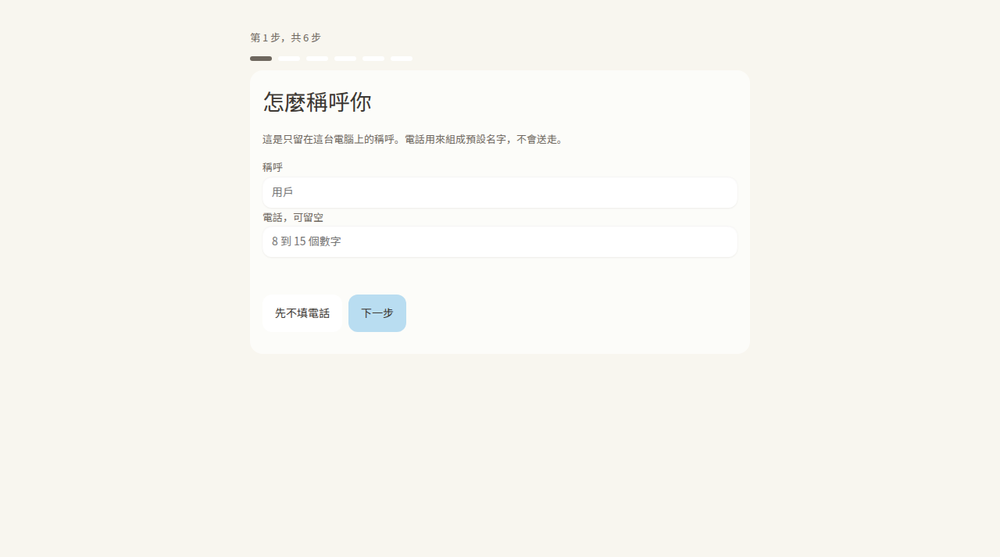

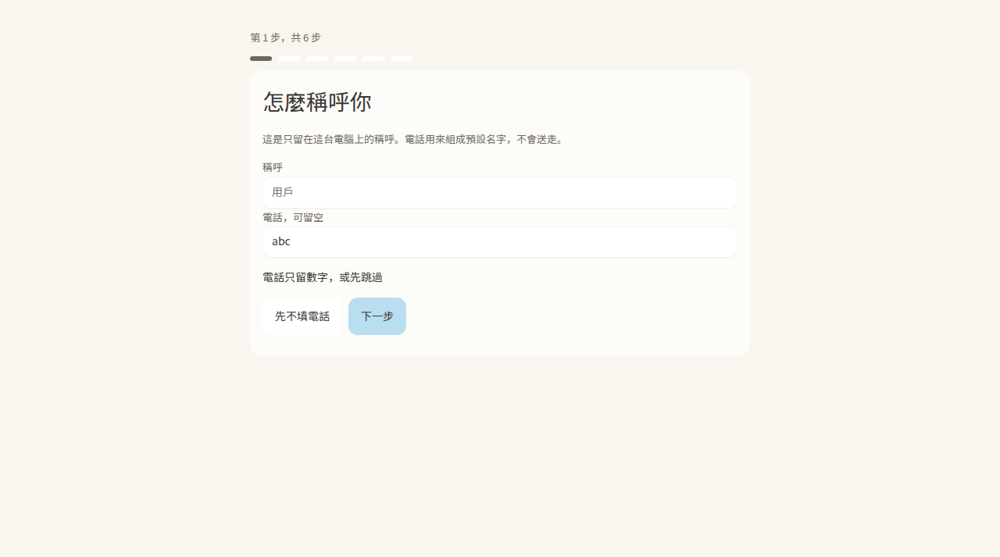

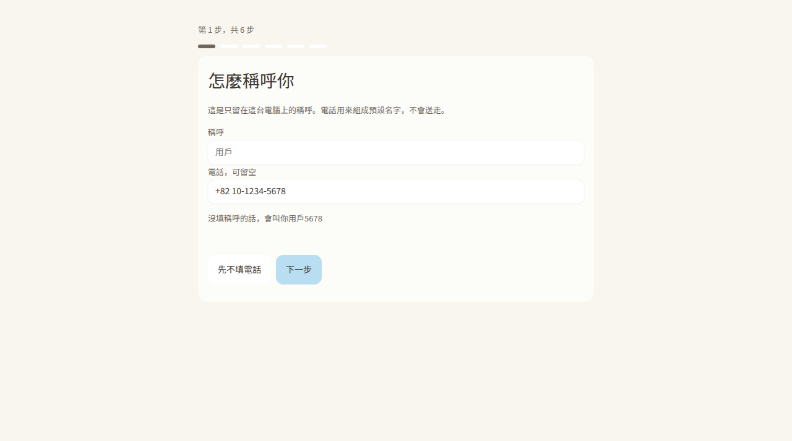

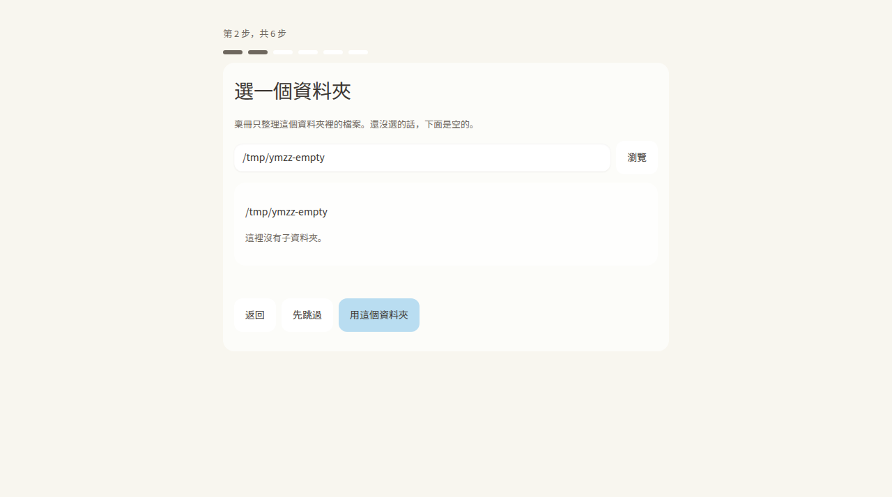

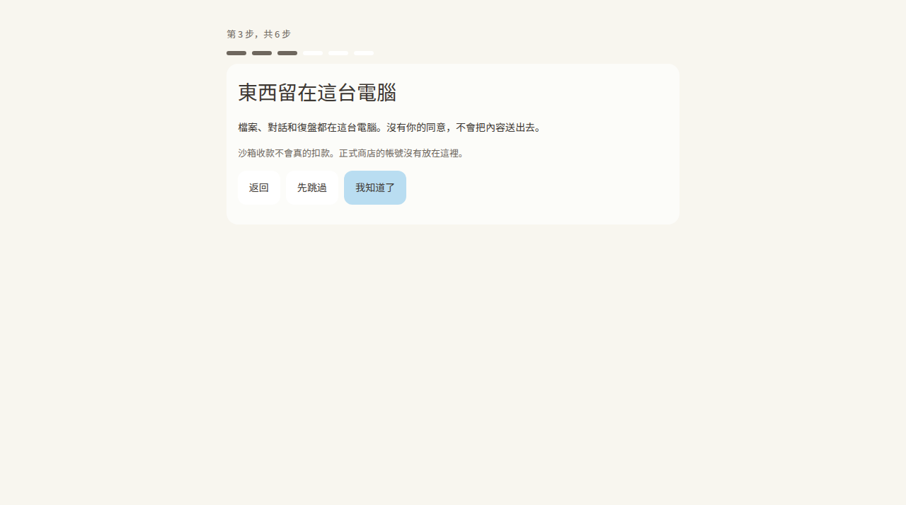

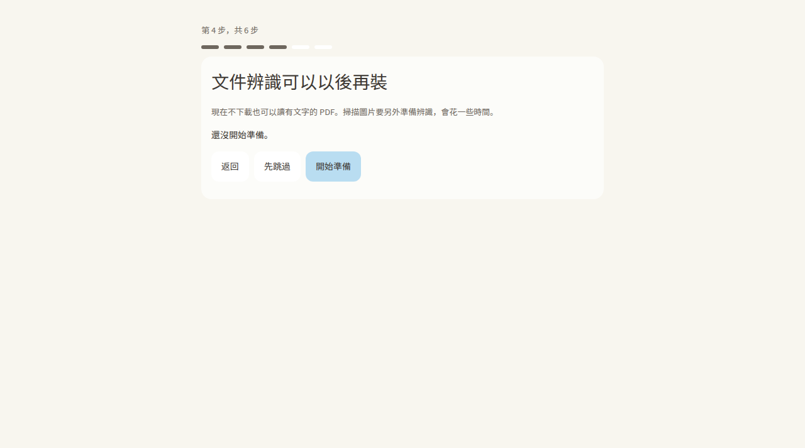

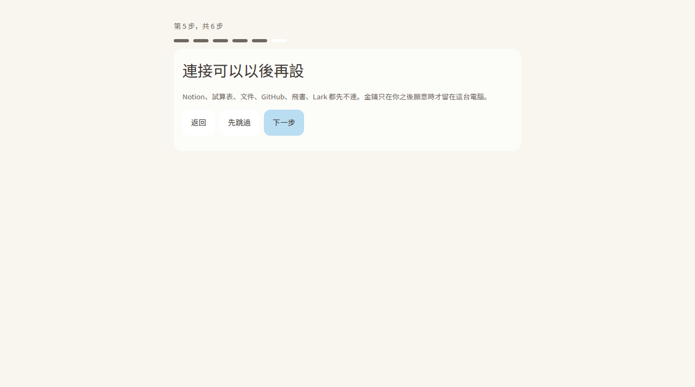

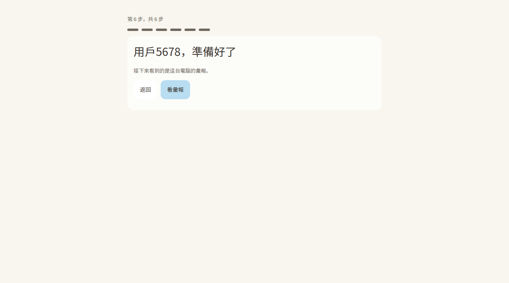

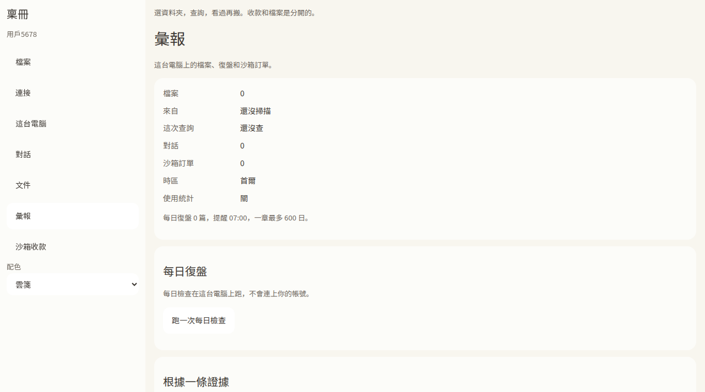

跳過資料夾時，彙報會先放進合成樣本和一則對話，所以數字不是空的。點數字就到那一頁。側欄、底部（窄螢幕）和「跳到」都能換頁。窄螢幕的側欄收成抽屜，不會蓋住彙報。

下面是 Linux 上用核心和瀏覽器點過的畫面。1100 寬是桌面，390 寬是手機寬度。手機上的圖要等 Android 模擬器工作流程把 `docs/mobile/` 交出來。

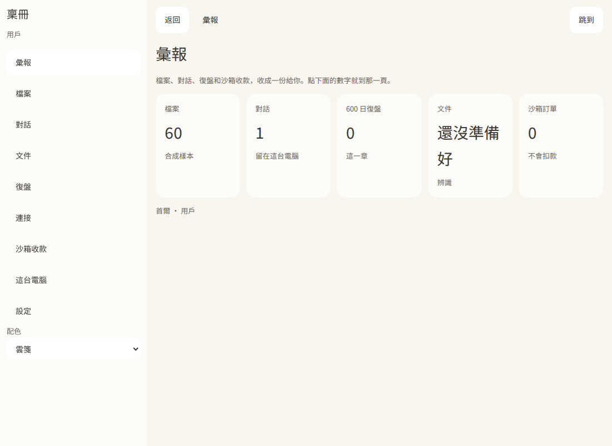

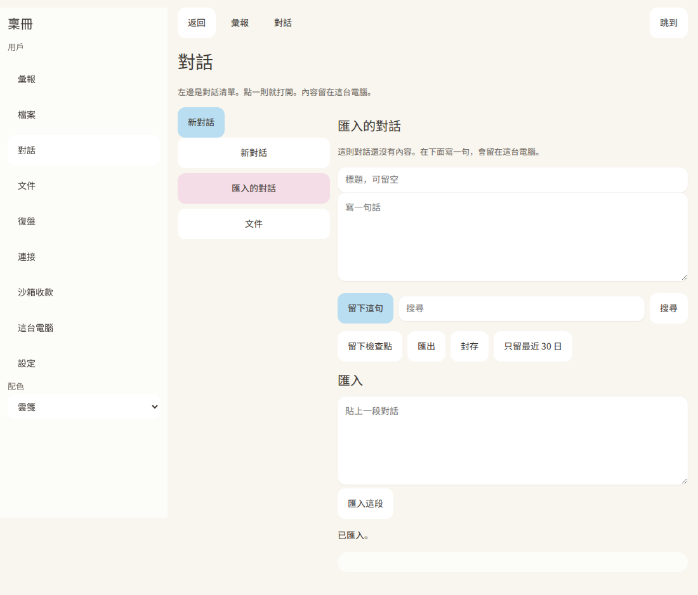

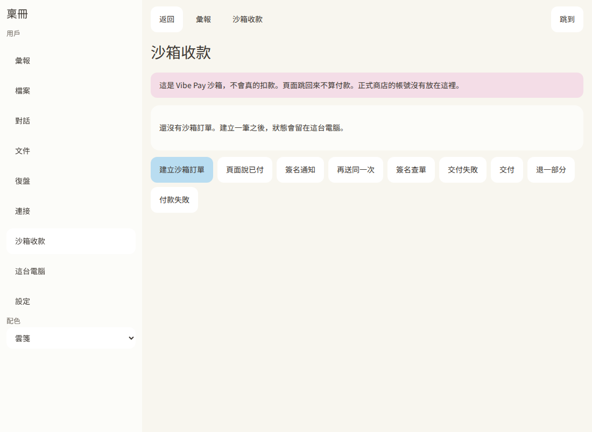

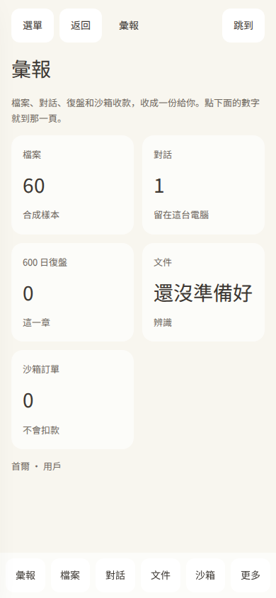

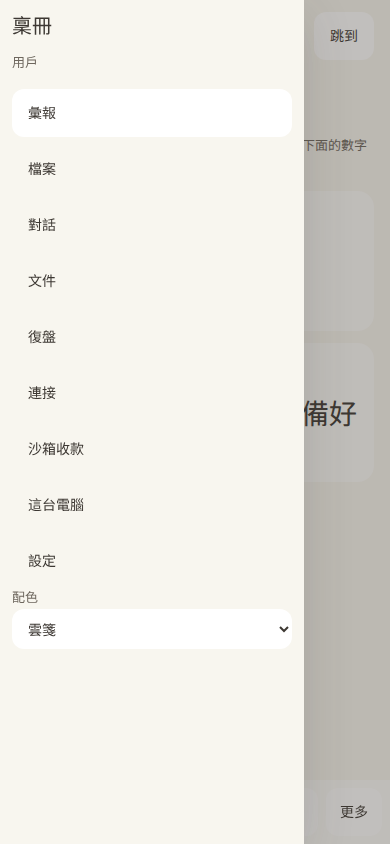

## 開始用

從安裝檔打開「稟冊」。視窗會連到這台電腦上的 `127.0.0.1`，不需要先裝別的執行環境。

若你是從原始碼跑，在儲存庫根目錄：

```sh
sh scripts/prepare-tauri-core.sh
cargo install tauri-cli --version 2.12.4 --locked
cargo tauri build --bundles deb,appimage
```

第二行的 `cargo tauri` 要在 `src-tauri` 目錄執行，或加上 `--config src-tauri/tauri.conf.json`。核心必須先編譯，視窗才找得到它。

## 裡頭有什麼

- 檔案整理：選資料夾、掃描、查詢、寫入筆記。這是原來 v0.20 那條線。
- 對話紀錄：留在本機。可以看、搜尋、匯入一份合成匯出、設定保留天數。Codex 與 Claude 的路徑只看本機有沒有那個程式，不把句子送到帳號。
- 600 日復盤：彙報上可以跑每日檢查。檢查在這台電腦上，不連你的帳號。
- 彙報：檔案數、對話數、沙箱訂單、時區。這台機器沒有自己的時區時，顯示首爾。
- 文件：有文字的 PDF 會收進可搜尋的紀錄。沒有文字層的 PDF 會請你改選圖片。掃描圖片要另外準備辨識。
- 沙箱收款：Vibe Pay 沙箱。頁面跳回來不算付款。不會真的扣款。正式商店的帳號沒有放在這裡。

## 套件

2026-11-10 查過：npm 上的 `ymzz`、`@ymzz/bingce`，以及 PyPI 上的 `ymzz`、`ymzz-bingce`，都還沒有人發佈。

本儲存庫裡有兩份還沒發佈的套件：

- `packages/ymzz`：Node SDK 與 `ymzz` 指令。算預設稱呼和 600 日章節。`npm test` 與 `npm pack` 已通過。
- `packages/ymzz-py`：Python SDK。算稱呼，並拒絕危險的封存路徑。`python -m build` 與 `twine check` 已通過。

沒有你的權杖，不會發佈。你要發佈時：

1. 在 npm 建立帳號，把 Automation token 存成這個儲存庫的 Actions secret，名字必須是 `NPM_TOKEN`。
2. 在 PyPI 用 Trusted Publishing，專案名 `ymzz`，對準工作流程 `.github/workflows/publish-packages.yml`。
3. 到 Actions 手動跑 `publish-packages`，把輸入 `publish` 設為 true。預設是 false，只打包、不發佈。沒有 `NPM_TOKEN` 時，npm 那一步會失敗而且不會上傳。

## 現況

| 項目 | 狀態 |
| --- | --- |
| 本機核心、彙報、檔案整理、沙箱收款 | 有測試，在這台電腦上跑過 |
| 第一次開啟的六個畫面 | Linux 上點過，截圖在上面 |
| 頁面跳轉、不用打路徑、窄螢幕選單 | Linux 上用核心點過 88 個控制項，含 390 寬的抽屜。截圖在上面。沒有要自己打的路徑欄 |
| Tauri 2 視窗 | 桌面版的核心仍在視窗旁邊，頁面走 `127.0.0.1`。手機版把同一個核心編成函式庫，頁面用一條指令跟它說話。核心改用穩定版 Rust，因為要和 Tauri 2.12 用同一套套件 |
| Linux / Windows / macOS 安裝檔 | 0.21.0 草稿裡已有。0.21.1 由這次工作流程做成新草稿。Windows 另有 tauri-driver 檢查，macOS 與 Linux 是把打好的包打開，看 `127.0.0.1:1413` 有沒有回稱呼頁。結果以工作流程日誌為準 |
| Android、iOS | Android 會在免費的 GitHub 模擬器裡安裝 x86_64 除錯包，看稱呼和彙報。給人側載的是 aarch64 的 apk。iOS 只試模擬器，失敗不會擋下桌面草稿。沒有上架 |
| 辨識模型 | 要另外準備。有文字的 PDF 不需要它 |
| 連接 Notion、試算表、文件、GitHub、飛書、Lark | 可以預覽和保存金鑰。沒有用你的帳號真的呼叫 |
| 對話和 Claude / Codex 帳號 | 沒有把句子送出去。不能說已經和那些產品對等 |
| npm、PyPI | 包好了，沒發佈 |
| 授權 | 仍是 MIT |

對打的細節在 `docs/v021-adversarial.md`。修過的一件事：嚮導原本蓋不住後面的檔案頁。安全檢查包含未授權寫入、電話不外洩、以及不讀符號連結。

---

# Bingce

Bingce (稟冊) is the local steward under the ymzz brand, 晏銘湛箴, and the Alipay PAYATHON 2026 Vibe Pay track entry. The design Skill lives in a separate repository and is the Skill-track entry. Bingce stays on your computer and brings you a briefing of files, conversations, the daily review, and a sandbox payment. The nickname, phone number, and keys stay on that computer.

The product is the briefing brought to its owner, and the local record that briefing comes from.

## Downloads

The [installer workflow](https://github.com/Ya-MiC/ymzz-loop/actions/workflows/installers.yml) on branch `cursor/v0211-mobile-core-e023` attaches 0.21.1 files to a new private draft pre-release, `v0.21.1-preview`, after that run succeeds. It does not replace the 0.21.0 draft. Drafts are free and visible only after you sign in: [Releases](https://github.com/Ya-MiC/ymzz-loop/releases). The repository default branch is still `main`, so the landing page is not this product README. The product README is on `product`.

| System | File | Status |
| --- | --- | --- |
| Windows | `.msi` and `.exe` | On the 0.21.0 draft. 0.21.1 waits for the new draft. The core stays beside the window |
| macOS | unsigned Apple silicon `.dmg` | Same. Right-click and choose Open if Gatekeeper blocks it |
| Linux | `.deb` and `.AppImage` | Same |
| Android | unsigned sideload `.apk`; Play needs an `.aab` | 0.21.1 links the local core into the app. An x86_64 debug build is what the emulator opens. The sideload file is aarch64. Screenshots land in `docs/mobile/` when that job passes. No `.aab`, nothing uploaded to Google Play |
| iOS | simulator `.app` | The same core is linked into the simulator target. No `.ipa`, no device signature, no TestFlight, no App Store |

If macOS blocks the unsigned app: right-click it, choose Open, then Open again. Or use System Settings → Privacy & Security → Open Anyway.

Google Play still needs your own developer account. The listing to prepare is the name 稟冊, package `dev.ymzz.bingce`, an `.aab`, and a privacy description that says data stays on the device and the payment screen does not charge. Do not treat a sideload APK as a store upload.

## First run

Six screens, in Traditional Chinese: nickname, folder, local-only explanation, optional recognition download, optional connectors, then the briefing. The default nickname is 用戶 plus the last four digits of a phone number kept only on this computer. Screenshots from Linux are in the Chinese section above.

## What is included

File organization from v0.20, local conversation records, a 600-day review, the briefing, document reading, and the Vibe Pay sandbox. Suggested places replace typed paths. Cards, the sidebar, the narrow-screen drawer, and the jump palette all open a real page. The sandbox does not charge. A page redirect is not a payment. No merchant account is stored here. This is not a claim that the contest is won, and there is no paid-user result.

## Packages

On 2026-11-10, `ymzz` and `@ymzz/bingce` were unpublished on npm, and `ymzz` and `ymzz-bingce` were unpublished on PyPI. This repo contains `packages/ymzz` and `packages/ymzz-py`. `npm pack` and `twine check` passed. Nothing was published.

To publish: set the Actions secret `NPM_TOKEN`, configure PyPI trusted publishing for project `ymzz` and workflow `publish-packages.yml`, then run that workflow manually with `publish` set to true.

## Status

The local core, the six-step first run on Linux, and the Tauri 2 window are in this branch. A Linux click-through drove 88 controls, including the 390px drawer, against the core in a browser. Desktop builds still start the core beside the window. Phone builds call that core in-process. The 0.21.0 draft still has the previous installers. The 0.21.1 draft is created only when the new installer run is green. Windows proof is a tauri-driver session against the debug window. macOS and Linux proof is the packaged app serving `127.0.0.1:1413`. Android proof is the emulator job. Those results are whatever the workflow logs say, not a claim made in advance. Connectors are previews. Conversation tools do not send text to Claude or Codex accounts. The license is still MIT. The approved palette is unchanged.

Adversarial notes: `docs/v021-adversarial.md`.

## 0.21.0 那一次

- 檢查（`ci`）：[成功](https://github.com/Ya-MiC/ymzz-loop/actions/runs/42803997216)
- 核心測試（`v021`）：[成功](https://github.com/Ya-MiC/ymzz-loop/actions/runs/42803995214)
- 桌面安裝檔在 0.21.0 草稿：[42803995058](https://github.com/Ya-MiC/ymzz-loop/actions/runs/42803995058)。那次的 Android 與 iOS 檔沒有本機核心。

0.21.1 的草稿、模擬器截圖和 Windows 的 tauri-driver 結果，等這次分支上的工作流程跑完再記。沒有上架。
