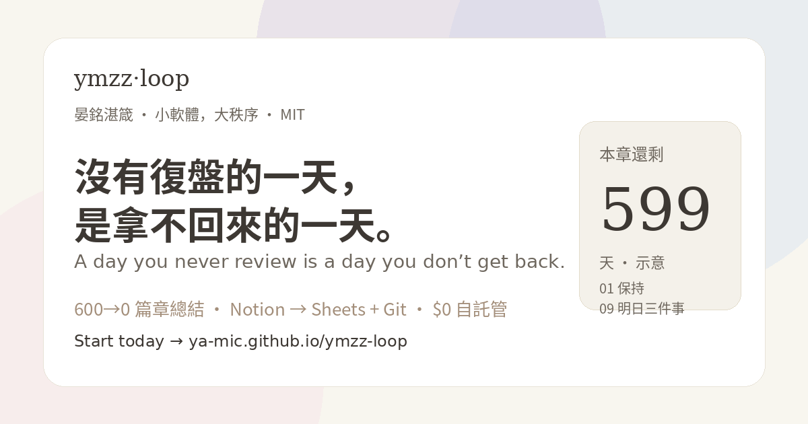
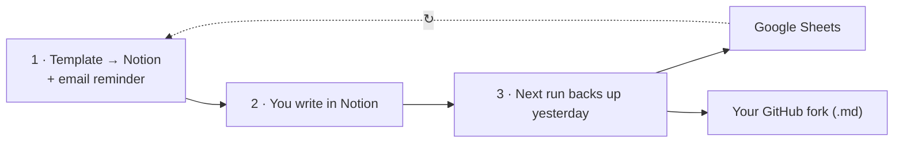

<p align="center"></p>

<p align="center"><b>English</b> · <a href="README.zh-Hant.md">繁體中文</a> · <a href="README.zh-CN.md">简体中文</a> · <a href="README.ko.md">한국어</a></p>

# ymzz-loop
**A day you never review is a day you don’t get back. Start today.**  
One deploy = one **600-day chapter** of daily review, counting **600→0** — a gentle clock, then a **600-day summary** and the loop pauses.  
GitHub Actions in **your** fork opens today’s blank page in Notion, emails the link, and **auto-ingests yesterday** into Google Sheets + your GitHub Markdown (optional Feishu).  
**$0 · MIT · multi-end · no AI quota · any time zone** — Notion write → Sheets + Git (+ Feishu).  
**[Open the site & 15-min setup →](https://ya-mic.github.io/ymzz-loop/)** · [Architecture](docs/architecture.md) · [Changelog](CHANGELOG.md)

<p align="center">
<a href="https://github.com/Ya-MiC/ymzz-loop/actions/workflows/ci.yml"></a>
<a href="LICENSE"></a>

</p>


## How the loop works



1. **In** — at your chosen time, a blank daily-review template is created in your Notion and you get an email with the link.
2. **Write** — fill it in on any device.
3. **Keep** — the next run copies yesterday to Google Sheets and to `notion/YYYY/*.md` in your own fork. Then it repeats every day until the chapter ends with a summary (600→0).

## What it does
At the time you choose (default **07:00 UTC**), GitHub Actions:
1. creates today's blank review page in Notion (sections ①–⑩);
2. emails you a link to that page;
3. syncs **yesterday's** review and your current holdings to Google Sheets (tabs 「每日復盤」 and 「持倉」), optionally to **Feishu / Lark Bitable** (see [docs/feishu.md](docs/feishu.md)), and to `notion/YYYY/MMDD_HHMM_<zone>.md` in this repo (e.g. `1105_0705_utc.md`; the zone is written inside).

It uses only GitHub's free Actions minutes and the free Notion/Google APIs. **Chapter (600→0):** first success starts with **600 days remaining**; each calendar day decrements; at **0** the daily loop **pauses** so the chapter can close with a **600-day summary**. Deploy a newer ymzz-loop version for the next chapter; your Notion / Sheets / Markdown stay yours. Until then, each run re-enables the schedule, a keepalive commit is added after 45 quiet days (GitHub pauses schedules after 60), runs time out after 10 minutes, and failures email you.

## Template
- **Daily Review**: date, score, mood, energy, Keep, Problem, Try, decisions, top 3 for tomorrow, inputs, platforms, market/holdings notes, deep-work hours, done.
- **Holdings** (any broker, entered by you): ticker, platform, class, quantity, cost, price, value, currency, weight, thesis, stop/target, updated, note.
- Frameworks: KPT (Keep/Problem/Try), Zeng Guofan's daily self-review, Lyubishchev time log, trading-journal daily review (Brett Steenbarger).

## Time zone
| Where | Example | Priority |
|---|---|---|
| Repo Variables `YMZZ_TZ` / `YMZZ_REMIND_TIME` | `America/Los_Angeles` / `21:30` | 1 |
| `sync.config.json` `timezone` / `remind_time` | `Asia/Seoul` / `07:00` | 2 |
| Default | `Etc/UTC` / `07:00` | 3 |

Cron is UTC-only, so the workflow wakes hourly. A dependency-free gate exits in seconds unless local time ≥ your reminder time and today hasn't run (`.ymzz/last-run`). Late or skipped schedules catch up the next hour. Public repos: free; private: ≈720 min/month, under the 2,000 free minutes.

## Setup (once, ~15 min)
1. **Notion integration** — https://www.notion.so/profile/integrations → New integration (Internal) named `ymzz` → copy the token. Open your review page → `⋯` → Connections → add `ymzz`.
2. **Create databases** (Node.js 20+):
   ```bash
   git clone https://github.com/<you>/ymzz-loop && cd ymzz-loop
   NOTION_TOKEN=<token> ./setup.sh "https://www.notion.so/<your-page>"
   git add sync.config.json && git commit -m "setup ids" && git push
   ```
   Windows PowerShell: `$env:NOTION_TOKEN="..."; npm install; node scripts/setup-notion.mjs "<page URL>"`
3. **Google service account** — https://console.cloud.google.com → new project → enable Google Sheets API → IAM → Service accounts → create → Keys → Add key → JSON. Create a Google Sheet and **share** it with the service-account email (Editor). `SHEET_ID` is the part in `/d/<SHEET_ID>/edit`.
4. **Gmail app password** — https://myaccount.google.com/apppasswords (requires 2-Step Verification) → 16-character password.
5. **GitHub Secrets** — Settings → Secrets and variables → Actions → New repository secret:

   | Secret | Value |
   |---|---|
   | `NOTION_TOKEN` | Notion integration token |
   | `GOOGLE_SERVICE_ACCOUNT_JSON` | the whole JSON file |
   | `SHEET_ID` | Google Sheet ID |
   | `SMTP_USER` | your Gmail |
   | `SMTP_PASS` | 16-character app password |
   | `MAIL_TO` | where reminders go |
   | `SMTP_HOST` / `SMTP_PORT` | optional, default smtp.gmail.com / 465 |
6. **Time zone (optional)** — Variables tab → `YMZZ_TZ` (IANA name, e.g. `America/Los_Angeles`) and `YMZZ_REMIND_TIME` (`HH:MM`). The website's picker generates both.
7. **First run** — Actions → daily-review → Run workflow. You should get an email, today's page in Notion, and two tabs in the Sheet.


## Donate / 贊助

ymzz-loop stays **free and MIT**. If it helps you, tips are welcome.

**USDC on Arbitrum One only. Sending other tokens or using other networks may lose funds.**

```
0x9C4345b0a652D063a79321fe099C65a7Dc5a9C3A
```

Receive-only address (no wallet connect on the site). QR and copy button: https://ya-mic.github.io/ymzz-loop/#donate · [ArbiScan](https://arbiscan.io/address/0x9C4345b0a652D063a79321fe099C65a7Dc5a9C3A)

## Extend
Optional Feishu secrets: `FEISHU_APP_ID`, `FEISHU_APP_SECRET`, `FEISHU_BITABLE_APP_TOKEN`, `FEISHU_BITABLE_TABLE_ID` (off when unset). Credits / font licenses: [CREDITS.md](CREDITS.md).

A new destination is one file: `scripts/sinks/<name>.mjs` implementing `{ name, enabled(env), write(ctx) }`. See [docs/architecture.md](docs/architecture.md).

## Community
[Contributing](CONTRIBUTING.md) · [Code of Conduct](CODE_OF_CONDUCT.md) · [Security](SECURITY.md) · [Third-party](THIRD_PARTY.md) · [Trademark](TRADEMARK.md)

## License
[MIT](LICENSE) © 2026 YanMing Cao · **晏銘湛箴** — Small software, big order.
ymzz-loop is independent and not affiliated with or endorsed by Notion, Google, GitHub, or Interactive Brokers.
