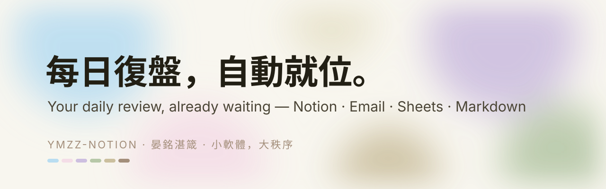
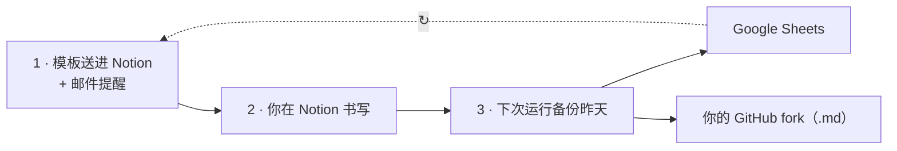

<p align="center"></p>

<p align="center"><a href="README.md">English</a> · <a href="README.zh-Hant.md">繁體中文</a> · <b>简体中文</b> · <a href="README.ko.md">한국어</a></p>

<p align="center">
<a href="https://github.com/Ya-MiC/ymzz-loop/actions/workflows/ci.yml"></a>
<a href="LICENSE"></a>


<a href="https://ya-mic.github.io/ymzz-loop/"></a>
</p>

<h1 align="center">ymzz-loop · 每日复盘</h1>
<p align="center"><b>每日复盘的多端数据同步产品。</b><br>
<strong>硬上限 600→0 湮灭／次部署</strong>——像比特币的 2100 万枚。<br>
作为产品用户，你 Fork 模板、绑定 Notion／Google／邮箱一次；GitHub Actions 在<em>你的</em> Fork 里每天建立今日空白复盘、寄出链接，并<strong>自动摄取前一日</strong>到 Google Sheets + Markdown（可选飞书，见 docs/feishu.md）。<br>
<strong>硬上限：一次部署最多 600 次每日复盘，从 600 倒数到 0 后湮灭</strong>（比特币 2100 万类比）——部署新版可重开窗口。<br>
$0 · 任意时区 · 无服务器 · 无 AI 配额 · MIT</p>

<p align="center"><a href="https://ya-mic.github.io/ymzz-loop/">🌐 官网与交互教学 Website & guided setup</a> · <a href="docs/architecture.md">🧩 架构 Architecture</a> · <a href="CHANGELOG.md">📜 Changelog</a></p>

---


## 循环如何运作



1. **送入**——在你选定的时间，Notion 自动建好空白的每日复盘模板，并发出带链接的提醒邮件。
2. **书写**——任何设备都能填。
3. **保存**——下一次运行把昨天的内容复制到 Google Sheets 与你 fork 里的 `notion/YYYY/*.md`。然后每天重复，直到 600→0 湮灭。

## 它做什么 What it does
每天在**你设置的时区与时间**（缺省 **07:00 UTC**），GitHub Actions 自动：
1. 在 Notion 建今天的空白复盘页（含 ①–⑩ 段落）/ creates today's blank review page in Notion
2. 寄信给你，附今日页面链接 / emails you the link
3. 把**昨天**的复盘 + 目前持仓同步到 Google Sheet（分页「每日复盘」「持仓」）与本仓库 `notion/YYYY/MMDD_HHMM_<时区>.md`（例如 `1105_0705_utc.md`，档内写明时区）/ syncs yesterday to Google Sheets and a markdown snapshot

不用 Grok / AI 额度，只用 GitHub 免费分钟。**寿命（600→0）：** 首次成功时剩余 **600** 天，每日递减，到 **0** 湮灭（比特币式硬上限）。部署更新版可重开。长期免维护：每小时闸门数秒结束、每天只真正运行一次（去重）、每次运行重新激活调度、45 天无提交自动补一次（避开 GitHub 60 天停用规则）、10 分钟逾时、失败寄信。
No AI quota; free GitHub minutes only. Built to run unattended.

| | ymzz-loop | 一般 Notion 模板 | 付费日记 App |
|---|---|---|---|
| 每日自动建页 + 提醒信 | ✅ | ❌ | ⚠️ |
| 同步 Google Sheet + Git 历史 | ✅ | ❌ | ❌ |
| 持仓表（任何券商）| ✅ | ⚠️ | ❌ |
| 任意时区 | ✅ | — | ✅ |
| 费用 | **$0** | $0–$20 | 订阅制 |

## 模板 Template
- **每日复盘 Daily Review**：日期、评分、心情、精力、Keep 做得好、Problem 问题、Try 教训、决策、明日三件事、信息输入、平台、市场/持仓笔记、深度工作时数、完成
- **持仓 Holdings**（任何券商，自行填写）：代号、平台、类别、数量、成本价、现价、市值、币别、占比、论点、停损/目标、更新日期、备注
- 方法来源 Frameworks: **KPT** (Keep/Problem/Try, Agile retrospectives) · **曾国藩日课・三省** · **柳比歇尔时间统计法** (Lyubishchev time log) · **交易日志每日复盘** (Brett Steenbarger, *The Daily Trading Coach*)

## 时区 Time zone
| 设置方式 | 范例 | 优先 |
|---|---|---|
| Repo Variables `YMZZ_TZ` / `YMZZ_REMIND_TIME` | `America/Los_Angeles` / `21:30` | 1 |
| `sync.config.json` `timezone` / `remind_time` | `Asia/Taipei` / `07:00` | 2 |
| 缺省 default | `Etc/UTC` / `07:00` | 3 |

GitHub 调度只支持 UTC，所以 workflow 每小时醒来一次：闸门不安装任何套件、数秒结束；只有「本地时间 ≥ 提醒时间 且 今天还没跑过」才真正运行（`.ymzz/last-run` 去重）。调度延迟或漏跑会在下一小时补上。公开仓库 Actions 免费；私人仓库约 720 分钟/月，低于免费 2,000 分钟。
Cron is UTC-only, so it wakes hourly; a dependency-free gate exits in seconds unless local time ≥ your reminder time and today hasn't run yet.

## 设置（每一位 Fork 的产品用户）

以下步骤是给 **你**（Fork／使用模板之后），不是只给作者。步骤 Setup（一次就好 / once）
1. **Notion integration**：到 https://www.notion.so/profile/integrations → New integration（Internal）名称 `ymzz` → 拷贝 token。打开你要放复盘的 Notion 页面 → 右上 `⋯` → Connections → 加入 `ymzz`。
2. **创建数据库 Create databases**（在电脑上 / on your PC，需 Node.js 20+）：
   ```bash
   git clone https://github.com/Ya-MiC/ymzz-loop && cd ymzz-loop
   NOTION_TOKEN=你的token ./setup.sh "https://www.notion.so/你的页面网址"
   git add sync.config.json && git commit -m "setup ids" && git push
   ```
   Windows PowerShell：`$env:NOTION_TOKEN="..."; npm install; node scripts/setup-notion.mjs "<页面网址>"`
3. **Google service account**：https://console.cloud.google.com → 新项目 → 激活 Google Sheets API → IAM → Service accounts → 创建 → Keys → Add key → JSON（下载）。建一个 Google Sheet，**共用**给 service account 的 email（编辑者 Editor）。网址 `/d/<SHEET_ID>/edit` 中间那段就是 SHEET_ID。
4. **Gmail 应用程序密码 App password**：https://myaccount.google.com/apppasswords（需先开两步验证）→ 创建 → 16 位密码。
5. **GitHub Secrets**：仓库 → Settings → Secrets and variables → Actions → New repository secret：

   | Secret | 内容 |
   |---|---|
   | `NOTION_TOKEN` | Notion integration token |
   | `GOOGLE_SERVICE_ACCOUNT_JSON` | 整个 JSON 档内容 whole JSON |
   | `SHEET_ID` | Google Sheet ID |
   | `SMTP_USER` | 你的 Gmail |
   | `SMTP_PASS` | 16 位应用程序密码 |
   | `MAIL_TO` | 收提醒的信箱 |
   | `SMTP_HOST` / `SMTP_PORT` | 选填，缺省 smtp.gmail.com / 465 |
6. **时区与提醒时间 Time zone（选填 optional）**：Settings → Secrets and variables → Actions → **Variables** 分页 → New repository variable：`YMZZ_TZ`（IANA 名称，例如 `Asia/Taipei`、`America/New_York`）、`YMZZ_REMIND_TIME`（`HH:MM`，例如 `21:30`）。不设就是 `Etc/UTC` `07:00`。也可直接改 `sync.config.json` 的 `timezone` / `remind_time`。官网的[时区产生器](https://ya-mic.github.io/ymzz-loop/#setup)会帮你算好。
7. **第一次手动运行 First run**：Actions → daily-review → Run workflow。收到信、Notion 出现今天的页、Sheet 出现两个分页就成功。

## 扩充 Extend
添加同步目的地＝添加一个 sink 档（`scripts/sinks/<name>.mjs`，实作 `{ name, enabled(env), write(ctx) }`）。详见 [docs/architecture.md](docs/architecture.md)。
Add a destination by dropping in one sink file — see the architecture doc.

## 文件 Files
| 路径 | 用途 |
|---|---|
| `.github/workflows/daily-review.yml` | 每小时闸门 + 每日流程 hourly gate + daily flow |
| `.github/workflows/ci.yml` · `pages.yml` | lint/test · 官网部署 website deploy |
| `setup.sh` → `scripts/setup-notion.mjs` | 建首页说明＋数据库 |
| `scripts/schema.mjs` | 字段与页面骨架（改模板只改这里）|
| `scripts/time.mjs` · `gate.mjs` | 时区 time zone · 闸门与去重 gate & dedupe |
| `scripts/sinks/` | 同步目的地 sinks（markdown、sheets）+ email |
| `scripts/create-today.mjs` · `send-reminder.mjs` · `sync-yesterday.mjs` · `write-log.mjs` | 每日步骤 |
| `notion/YYYY/MMDD_HHMM_<tz>.md` | 每日快照（内含时区）|
| `site/` | 官网（GitHub Pages）|

## 社群 Community
[贡献 Contributing](CONTRIBUTING.md) · [行为准则 Code of Conduct](CODE_OF_CONDUCT.md) · [安全 Security](SECURITY.md) · [研究 Research](docs/research.md)

## 授权 License
[MIT](LICENSE) © 2026 YanMing Cao 曹晏铭 · **晏銘湛箴** — 小软件，大秩序。

## Donate / 赞助

ymzz-loop **保持免费、MIT**。欢迎打赏。

**USDC on Arbitrum One only. Sending other tokens or using other networks may lose funds.**

```
0x9C4345b0a652D063a79321fe099C65a7Dc5a9C3A
```

仅收款：https://ya-mic.github.io/ymzz-loop/#donate

