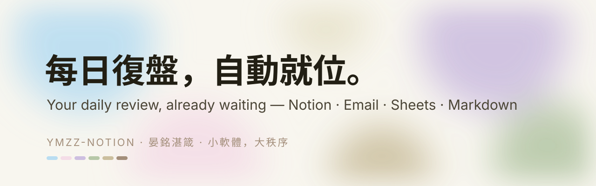
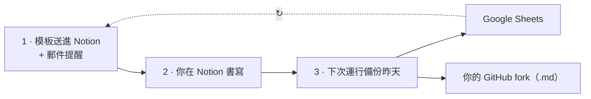

<p align="center"></p>

<p align="center"><a href="README.md">English</a> · <b>繁體中文</b> · <a href="README.zh-CN.md">简体中文</a> · <a href="README.ko.md">한국어</a></p>

<p align="center">
<a href="https://github.com/Ya-MiC/ymzz-loop/actions/workflows/ci.yml"></a>
<a href="LICENSE"></a>


<a href="https://ya-mic.github.io/ymzz-loop/"></a>
</p>

<h1 align="center">ymzz-loop · 每日復盤</h1>
<p align="center"><b>每日復盤的多端數據同步產品。</b><br>
作為產品使用者，你 Fork 模板、綁定 Notion／Google／信箱一次；GitHub Actions 在<em>你的</em> Fork 裡每天建立今日空白復盤、寄出連結，並<strong>自動攝取前一日</strong>到 Google Sheets + Markdown（可選飛書）。<br>
<strong>一次部署＝一段 600 天篇章</strong>（倒數 600→0），然後產出 <strong>600 天總結</strong>、每日迴圈暫停——部署新版開啟下一章。<br>
$0 · 任意時區 · 無伺服器 · 無 AI 配額 · MIT</p>

<p align="center"><a href="https://ya-mic.github.io/ymzz-loop/">🌐 官網與互動教學 Website & guided setup</a> · <a href="CREDITS.md">致謝 Credits</a> · <a href="docs/architecture.md">🧩 架構 Architecture</a> · <a href="CHANGELOG.md">📜 Changelog</a></p>

---


## 循環如何運作



1. **送入**——在你選的時間，Notion 自動建好空白的每日復盤模板，並寄出附連結的提醒信。
2. **書寫**——任何裝置都能填。
3. **留存**——下一次運行把昨天的內容複製到 Google Sheets 與你 fork 裡的 `notion/YYYY/*.md`。然後每天重複，直到本章以 600 天總結收束（可部署更新版開啟下一章）。

## 它做什麼 What it does
每天在**你設定的時區與時間**（預設 **07:00 UTC**），GitHub Actions 自動：
1. 在 Notion 建今天的空白復盤頁（含 ①–⑩ 段落）/ creates today's blank review page in Notion
2. 寄信給你，附今日頁面連結 / emails you the link
3. 把**昨天**的復盤 + 目前持倉同步到 Google Sheet（分頁「每日復盤」「持倉」）、可選**飛書多維表格**（見 [docs/feishu.md](docs/feishu.md)）與本倉庫 `notion/YYYY/MMDD_HHMM_<時區>.md`（例如 `1105_0705_utc.md`，檔內寫明時區）/ syncs yesterday to Google Sheets and a markdown snapshot

不用 Grok / AI 額度，只用 GitHub 免費分鐘。**篇章（600→0）：** 首次成功時剩餘 **600** 天，每日遞減，到 **0** 每日迴圈暫停並以 **600 天總結** 收束本章。部署更新版開啟下一章。到期前：每小時閘門數秒結束、每天只真正執行一次（去重）、每次執行重新啟用排程、45 天無提交自動補一次（避開 GitHub 60 天停用規則）、10 分鐘逾時、失敗寄信。
No AI quota; free GitHub minutes only. Hard-capped at 600 days from first success, then stops.

| | ymzz-loop | 一般 Notion 模板 | 付費日記 App |
|---|---|---|---|
| 每日自動建頁 + 提醒信 | ✅ | ❌ | ⚠️ |
| 同步 Google Sheet + Git 歷史 | ✅ | ❌ | ❌ |
| 持倉表（任何券商）| ✅ | ⚠️ | ❌ |
| 任意時區 | ✅ | — | ✅ |
| 費用 | **$0** | $0–$20 | 訂閱制 |

## 模板 Template
- **每日復盤 Daily Review**：日期、評分、心情、精力、Keep 做得好、Problem 問題、Try 教訓、決策、明日三件事、資訊輸入、平台、市場/持倉筆記、深度工作時數、完成
- **持倉 Holdings**（任何券商，自行填寫）：代號、平台、類別、數量、成本價、現價、市值、幣別、佔比、論點、停損/目標、更新日期、備註
- 方法來源 Frameworks: **KPT** (Keep/Problem/Try, Agile retrospectives) · **曾國藩日課・三省** · **柳比歇爾時間統計法** (Lyubishchev time log) · **交易日誌每日復盤** (Brett Steenbarger, *The Daily Trading Coach*)

## 時區 Time zone
| 設定方式 | 範例 | 優先 |
|---|---|---|
| Repo Variables `YMZZ_TZ` / `YMZZ_REMIND_TIME` | `America/Los_Angeles` / `21:30` | 1 |
| `sync.config.json` `timezone` / `remind_time` | `Asia/Taipei` / `07:00` | 2 |
| 預設 default | `Etc/UTC` / `07:00` | 3 |

GitHub 排程只支援 UTC，所以 workflow 每小時醒來一次：閘門不安裝任何套件、數秒結束；只有「本地時間 ≥ 提醒時間 且 今天還沒跑過」才真正執行（`.ymzz/last-run` 去重）。排程延遲或漏跑會在下一小時補上。公開倉庫 Actions 免費；私人倉庫約 720 分鐘/月，低於免費 2,000 分鐘。
Cron is UTC-only, so it wakes hourly; a dependency-free gate exits in seconds unless local time ≥ your reminder time and today hasn't run yet.

## 設定（每一位 Fork 的產品使用者）

以下步驟是給 **你**（Fork／使用模板之後），不是只給作者。步驟 Setup（一次就好 / once）
1. **Notion integration**：到 https://www.notion.so/profile/integrations → New integration（Internal）名稱 `ymzz` → 複製 token。打開你要放復盤的 Notion 頁面 → 右上 `⋯` → Connections → 加入 `ymzz`。
2. **建立資料庫 Create databases**（在電腦上 / on your PC，需 Node.js 20+）：
   ```bash
   git clone https://github.com/Ya-MiC/ymzz-loop && cd ymzz-loop
   NOTION_TOKEN=你的token ./setup.sh "https://www.notion.so/你的頁面網址"
   git add sync.config.json && git commit -m "setup ids" && git push
   ```
   Windows PowerShell：`$env:NOTION_TOKEN="..."; npm install; node scripts/setup-notion.mjs "<頁面網址>"`
3. **Google service account**：https://console.cloud.google.com → 新專案 → 啟用 Google Sheets API → IAM → Service accounts → 建立 → Keys → Add key → JSON（下載）。建一個 Google Sheet，**共用**給 service account 的 email（編輯者 Editor）。網址 `/d/<SHEET_ID>/edit` 中間那段就是 SHEET_ID。
4. **Gmail 應用程式密碼 App password**：https://myaccount.google.com/apppasswords（需先開兩步驗證）→ 建立 → 16 位密碼。
5. **GitHub Secrets**：倉庫 → Settings → Secrets and variables → Actions → New repository secret：

   | Secret | 內容 |
   |---|---|
   | `NOTION_TOKEN` | Notion integration token |
   | `GOOGLE_SERVICE_ACCOUNT_JSON` | 整個 JSON 檔內容 whole JSON |
   | `SHEET_ID` | Google Sheet ID |
   | `SMTP_USER` | 你的 Gmail |
   | `SMTP_PASS` | 16 位應用程式密碼 |
   | `MAIL_TO` | 收提醒的信箱 |
   | `SMTP_HOST` / `SMTP_PORT` | 選填，預設 smtp.gmail.com / 465 |
6. **時區與提醒時間 Time zone（選填 optional）**：Settings → Secrets and variables → Actions → **Variables** 分頁 → New repository variable：`YMZZ_TZ`（IANA 名稱，例如 `Asia/Taipei`、`America/New_York`）、`YMZZ_REMIND_TIME`（`HH:MM`，例如 `21:30`）。不設就是 `Etc/UTC` `07:00`。也可直接改 `sync.config.json` 的 `timezone` / `remind_time`。官網的[時區產生器](https://ya-mic.github.io/ymzz-loop/#setup)會幫你算好。
7. **第一次手動執行 First run**：Actions → daily-review → Run workflow。收到信、Notion 出現今天的頁、Sheet 出現兩個分頁就成功。


## Donate / 贊助

ymzz-loop **維持免費、MIT 開源**。若對你有幫助，歡迎打賞。

**USDC on Arbitrum One only. Sending other tokens or using other networks may lose funds.**

```
0x9C4345b0a652D063a79321fe099C65a7Dc5a9C3A
```

僅收款地址（官網不會要求連接錢包）。QR 與複製按鈕：https://ya-mic.github.io/ymzz-loop/#donate · [ArbiScan](https://arbiscan.io/address/0x9C4345b0a652D063a79321fe099C65a7Dc5a9C3A)

## 擴充 Extend
新增同步目的地＝新增一個 sink 檔（`scripts/sinks/<name>.mjs`，實作 `{ name, enabled(env), write(ctx) }`）。詳見 [docs/architecture.md](docs/architecture.md)。
Add a destination by dropping in one sink file — see the architecture doc.

## 檔案 Files
| 路徑 | 用途 |
|---|---|
| `.github/workflows/daily-review.yml` | 每小時閘門 + 每日流程 hourly gate + daily flow |
| `.github/workflows/ci.yml` · `pages.yml` | lint/test · 官網部署 website deploy |
| `setup.sh` → `scripts/setup-notion.mjs` | 建首頁說明＋資料庫 |
| `scripts/schema.mjs` | 欄位與頁面骨架（改模板只改這裡）|
| `scripts/time.mjs` · `gate.mjs` | 時區 time zone · 閘門與去重 gate & dedupe |
| `scripts/sinks/` | 同步目的地 sinks（markdown、sheets）+ email |
| `scripts/create-today.mjs` · `send-reminder.mjs` · `sync-yesterday.mjs` · `write-log.mjs` | 每日步驟 |
| `notion/YYYY/MMDD_HHMM_<tz>.md` | 每日快照（內含時區）|
| `site/` | 官網（GitHub Pages）|

## 社群 Community
[貢獻 Contributing](CONTRIBUTING.md) · [行為準則 Code of Conduct](CODE_OF_CONDUCT.md) · [安全 Security](SECURITY.md) · [研究 Research](docs/research.md)

## 授權 License
[MIT](LICENSE) © 2026 YanMing Cao 曹晏銘 · **晏銘湛箴** — 小軟體，大秩序。
